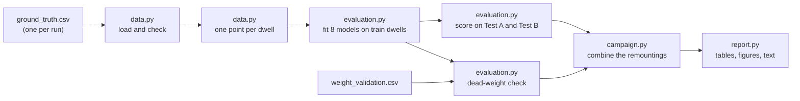

# Proximal force estimation for orthopaedic MIS instruments: analysis code

Analysis code for the Master's thesis *Force Sensing in Minimally Invasive
Orthopaedic Surgery*.

This repository contains the analysis of the recorded calibration runs. It
compares eight models that map the sensor reading to the tip force, measures
their accuracy, repeatability across remountings and robustness to loads
outside the training range, and checks the result against an independent dead
weight.

## Contents

```
force-estimation-analysis/
├── README.md
├── requirements.txt
├── results_report.py        command 1: tables, figures and text for the Results chapter
├── diagnostics_report.py    command 2: hysteresis, coupling, drift and compliance diagnostics
├── configs/
│   ├── analysis.yaml        all analysis settings (thesis values)
│   └── objects.yaml         geometry and material of the instrument and the screwdriver
├── forcecal/                analysis code used by both commands
│   ├── settings.py          reads and checks the two YAML files
│   ├── constants.py         CSV column names, units, frames S and EE, model list
│   ├── data.py              load runs, check them, reduce each dwell to one point
│   ├── models.py            object geometry and the eight models P0–D2
│   ├── evaluation.py        train/test splits, model fitting and scoring, dead-weight check
│   ├── metrics.py           ISO 376 quantities, drift, error metrics
│   ├── campaign.py          statistics across the repeated remountings
│   ├── diagnostics.py       hysteresis, coupling matrix, anchor drift, apparent EI
│   ├── plots.py             all figures
│   └── report.py            Markdown/LaTeX reports and run_info.json
├── tests/                   tests on synthetic data (no measurement data needed)
├── .github/workflows/       runs the tests automatically on every push
├── docs/conventions.md      frames, units, CSV columns, data splits, model table
├── data/README.md           where the measurement data is stored, expected layout
└── results/                 final outputs used in the thesis
```

## Quick start

```bash
pip install -r requirements.txt
pytest                                  # about 40 s, uses synthetic data only
```

Then place the measurement data as described in [`data/README.md`](data/README.md) and run:

```bash
python results_report.py                # writes results/thesis_results/
python diagnostics_report.py            # writes results/thesis_diagnostics/
```

Both commands read `configs/analysis.yaml`. Use `--config` for another settings
file and `--out` for another output folder.

## Analysis pipeline



Each run is one mounting of the instrument. Every run is analysed on its own
first (models fitted per run), then the runs are combined.


## Models

| ID | Model | Family | Fitted parameters |
|---|---|---|---|
| P0 | Direct-force equilibrium, F_tip = F_sensor | Physical | none |
| P1 | Fixed-lever moment model: transverse force from bending moment, F = M / L | Physical | none |
| P2 | Compliant-lever moment model: lever deformed with handbook EI | Physical | none |
| PA0 | Affine correction of P0, with the three sensor moments as extra inputs | Linear error | A (3×6), b |
| PA1 | Affine correction of P1, same inputs | Linear error | A (3×6), b |
| PA2 | Affine correction of P2, same inputs | Linear error | A (3×6), b |
| D1 | Quadratic regression on the six sensor channels | Data-driven | 27 coefficients per axis |
| D2 | Multilayer perceptron (2 × 64) on the six sensor channels | Data-driven | network weights |

Details and the equations are in [`docs/conventions.md`](docs/conventions.md)
and at the top of [`forcecal/models.py`](forcecal/models.py).

## Changing settings

All values that can be changed without changing a formula are in two files:

- [`configs/analysis.yaml`](configs/analysis.yaml): data location, dwell
  settling, validation split, seed, bootstrap counts, model settings,
  requirement thresholds, reference values, figure resolution.
- [`configs/objects.yaml`](configs/objects.yaml): lengths, shaft section and
  Young's modulus of each test object.

Every key is required. An unknown or misspelt key stops the program with an
error message, so a typo cannot fall back to a hidden default. For a variant
(for example a quick run without the MLP), copy `analysis.yaml` under a new
name and pass it with `--config`. Each output folder contains `run_info.json`
with the settings used, the input files (with SHA-256 checksums), the git
commit and the package versions.

## Conventions

The reported forces are in the **sensor frame S**, where the shaft axis is
**z**: the axial force is **Fz**. The sensor moment columns end in `_Nm` but
hold **Nmm**. See [`docs/conventions.md`](docs/conventions.md).

## Author

Albin <surname>, MSc Mechanical Engineering, ETH Zürich. Master's thesis at ROCS.
Contact: <email>
