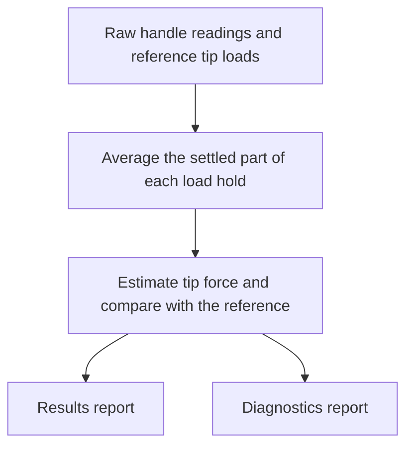

# Tip-force estimation for handheld orthopaedic instruments

## 1. Project overview

This project estimates the force at the tip of an unmodified handheld
orthopaedic instrument from measurements near its handle. Mounting the
sensor proximally keeps it away from the narrow working tip, where
integration would add space, manufacturing and sterilisation constraints.
The output is an estimate of the three tip-force components in newtons.

The benchtop experiment uses a commercial instrument with a 330 mm long,
4 mm diameter shaft. A ring-shaped ReSense HEX-32 mounted around the
shaft records three forces and three moments. A Force Dimension Lambda.7
haptic device applies loads in controlled directions at the tip. The
procedure aligns the two devices’ coordinate frames, then applies
five-second force holds. The analysis averages the final 60% of each
hold after the readings have had time to settle.

The study compares eight models, from direct force readings and
lever-arm calculations to fitted corrections and nonlinear models. The
fitted models are calibrated on loads up to 4 N. Test A uses separate
force and direction combinations within that range. Test B uses 6 N
loads in directions represented in training, so it tests extrapolation
in magnitude. The procedure is repeated across eight sensor mountings.
The reports summarise prediction errors, fitted calibration coefficients
and measurement effects such as drift and cross-axis coupling.



### Models used to estimate tip force

The physical models test what can be estimated from the measured forces,
bending moments and instrument geometry. The affine models add a fitted
linear map and an offset to account for systematic differences. The
data-driven models learn a relationship directly from the sensor readings.

| Model | Family | How it estimates tip force |
| --- | --- | --- |
| **P0** · Direct force | Physical | Uses the three forces measured at the handle as the tip-force estimate. |
| **P1** · Fixed lever arm | Physical | Estimates the two sideways forces from the bending moments using a fixed distance from the sensor to the tip. Takes the force along the shaft from the sensor. |
| **P2** · Compliant lever arm | Physical | Uses the same approach as P1 and adjusts the lever arm to account for shaft bending. |
| **PA0** · Affine direct force | Affine | Fits a linear map and an offset using the P0 estimate and the three measured moments. |
| **PA1** · Affine fixed lever arm | Affine | Fits the same type of map using the P1 estimate and the three measured moments. |
| **PA2** · Affine compliant lever arm | Affine | Fits the same type of map using the P2 estimate and the three measured moments. |
| **D1** · Quadratic regression | Data-driven | Fits linear, squared and pairwise terms from the six measured force and moment channels. |
| **D2** · Multilayer perceptron | Data-driven | Trains a neural network on the same six measured channels. |

### What comes out of the analysis

| Output | What it tells you |
| --- | --- |
| [Results report](results/thesis_results/results_skeleton.md) | Compares model accuracy on Test A and Test B, repeatability within a mounting, and variation across mountings. It also tests calibration transfer and checks force magnitude against a known weight. |
| [Diagnostics report](results/thesis_diagnostics/diagnostics_report.md) | Shows where the errors occur and which measurement effects may help explain them. It covers differences between loading and unloading, responses on other sensor axes, drift under repeated loads, apparent bending stiffness, and predicted versus delivered forces. |

### What the experiment found

The study reports the median root mean squared error (RMSE) across the eight
mountings, pooling errors over the three force components. On Test A, the
direct-force baseline (P0) had a median RMSE of **1.431 N**. An affine
correction of that baseline (PA0) reduced it to **0.446 N**. The neural
network (D2) achieved the lowest median error, **0.415 N** on Test A and
**0.531 N** on Test B. Allowing the lever arm to change as the shaft bent
had little effect over the tested range. [Results report](results/thesis_results/results_skeleton.md)

The paper assesses how consistently the procedure works when the sensor
is remounted and the models are recalibrated. The repository also reports
what happens when a fitted model is reused on another mounting without
recalibration. For PA0, the median Test A error increased from **0.446 N**
within the fitted mounting to **0.595 N** across mountings.
[Calibration transfer results](results/thesis_results/results_skeleton.md#443-calibration-transfer-without-refitting)

The study used one instrument under slowly applied, steady loads on a
bench without a trocar, the access port used in surgery. The reported
errors describe agreement with a reference force derived from the
Lambda.7 command and device state. A separate known-weight check provides
an independent reference for force magnitude. The estimates cover tip
force. The experiment applied no tip torques.

## 2. Code guide

### Architecture

Two scripts run the analysis. `results_report.py` calculates the model
comparisons and summaries across mountings. `diagnostics_report.py` uses
the same data loading, preprocessing and model evaluation to investigate
measurement behaviour. Both read the same configuration and use the
`forcecal` package for calculations, plots and report writing. Each
script can run directly from the recordings.

### Repository organisation

```text
force-estimation-analysis/
├── README.md                   Project overview and code walkthrough
├── results_report.py           Entry point for thesis results and model comparison
├── diagnostics_report.py       Entry point for measurement and model diagnostics
├── configs/
│   ├── analysis.yaml           Dataset, preprocessing, model and evaluation settings
│   └── objects.yaml            Geometry and material properties of each test object
├── forcecal/
│   ├── __init__.py             Package description and version
│   ├── settings.py             Loads and validates both YAML files
│   ├── constants.py            CSV columns, units, coordinate transforms and model IDs
│   ├── data.py                 Discovers, loads, audits and reduces recordings
│   ├── models.py               Instrument geometry and force estimator implementations
│   ├── evaluation.py           Data splits, model fitting, scoring and dead-weight check
│   ├── metrics.py              Repeatability, reproducibility, drift and error metrics
│   ├── campaign.py             Summaries, comparisons and calibration transfer across runs
│   ├── diagnostics.py          Hysteresis, coupling, drift, stiffness and residual analysis
│   ├── plots.py                Plotting functions for both reports
│   └── report.py               Writes reports, tables and reproducibility metadata
├── data/
│   ├── README.md               Recording layout and CSV formats
│   ├── instrument_data/        Default thesis dataset
│   │   └── test_50/ … test_57/  One folder per mounting
│   │       ├── ground_truth.csv       Handle measurements, delivered force and load labels
│   │       ├── alignment_log.csv      Alignment status and controller log
│   │       └── weight_validation.csv Separate known-mass recording
│   └── screwdriver_data/       Screwdriver recordings with the same layout
├── docs/
│   └── conventions.md          Coordinate frames, units, data splits and model equations
├── results/
│   ├── README.md               Output folders and provenance
│   ├── thesis_results/
│   │   ├── results_skeleton.md  Main thesis results in Markdown
│   │   ├── results_skeleton.tex Main thesis results in LaTeX
│   │   ├── tables/             Model metrics, remount comparisons and validation CSVs
│   │   ├── figures/            Figures for the thesis results
│   │   └── run_info.json       Settings, input checksums and software versions
│   └── thesis_diagnostics/
│       ├── diagnostics_report.md Diagnostic findings in Markdown
│       ├── tables/             Diagnostic summaries and per-dwell predictions
│       ├── figures/            Diagnostic plots by load, channel and model
│       └── run_info.json       Settings, input checksums and software versions
├── tests/
│   ├── conftest.py             Shared pytest settings fixtures and config writer
│   ├── synthetic.py            Generates synthetic calibration recordings
│   ├── test_frames.py          Checks coordinate transforms and shaft-axis conventions
│   ├── test_models.py          Checks physical estimators against known inputs
│   ├── test_pipeline.py        Exercises per-run analysis and both report commands
│   └── test_settings.py        Checks valid and invalid configuration
├── requirements.txt            Pinned Python dependencies
├── pytest.ini                  Pytest configuration
├── .gitignore                  Local files and outputs excluded from Git
└── .github/workflows/tests.yml  Runs the synthetic tests on pushes and pull requests
```

The tree groups repeated recordings and report artifacts by directory.
Browse the full [recordings](data/) and [generated reports, tables and figures](results/).

### Files and functions by analysis stage

Read the entry point first, then follow the relevant functions for one
recording. A constant-load hold is called a **dwell** in the code.

| Stage | What happens | Where to read |
| --- | --- | --- |
| Start the analysis | Load the settings and geometry, find the recordings, and start the per-run analysis. | [`results_report.py`](results_report.py#L169) calls [`analyse_run()`](results_report.py#L79-L91). [`diagnostics_report.py`](diagnostics_report.py#L72) uses [`load_campaign()`](forcecal/diagnostics.py#L70). [`load_settings()`](forcecal/settings.py#L144) validates the YAML files. |
| Load and preprocess a run | Read the time series and metadata, express the force columns in the sensor frame, and audit the recording for the Results report. For each dwell, discard the first 40% with the thesis settings, remove repeated sensor messages when possible, and keep the means, standard deviations, sample counts and quality flag. | [`data.py`](forcecal/data.py) contains `discover_campaign()`, `load_run()`, `audit_run()` and `reduce_dwells()`. [`constants.py`](forcecal/constants.py) defines channel names, units and coordinate transforms. |
| Fit and evaluate the models | Use the labelled training dwells to fit the models that require calibration. Reserve whole series of stepped loads for validation. Score Test A and Test B separately against the delivered force. | [`run_model_comparison()`](forcecal/evaluation.py#L103) calls `make_splits()`, [`build_models()`](forcecal/models.py#L397) and `compare_models()`. [`metrics.py`](forcecal/metrics.py) provides direction error, repeatability and drift calculations. |
| Combine results across runs | Summarise model errors, measure within-mounting repeatability and between-mounting spread, test calibration transfer and inspect the PA0 matrix. Compare estimated force magnitude with the expected force from a known mass when a weight recording is available. | [`campaign.py`](forcecal/campaign.py) contains `model_summary_from_channels()`, `between_remount_spread()`, `transfer_from_records()` and `pa0_decomposition()`. [`weight_validation()`](forcecal/evaluation.py#L310) handles the known-mass test. |
| Investigate measurement behaviour | Calculate cross-axis coupling, hysteresis, drift at repeated reference loads and apparent bending stiffness. Examine how prediction errors change with load. | [`diagnostics.py`](forcecal/diagnostics.py) contains `transmission_matrices()`, `hysteresis_table()`, `anchor_table()`, `apparent_ei()` and `prediction_rows()`. |
| Write the outputs | Generate figures and write the Markdown reports, the LaTeX version of the Results report, and CSV tables. Each output folder contains a record of the settings, input file checksums and package versions. | [`plots.py`](forcecal/plots.py) creates the figures. [`report.py`](forcecal/report.py) contains `write_results_report()`, `write_diagnostics_report()` and `write_run_info()`. |

These calls in [`analyse_run()`](results_report.py#L79-L91) show how one
raw recording becomes the dwell table used for model comparison.

```python
df, meta = load_run(gt)
audit = audit_run(df, meta)
dw = reduce_dwells(df, meta, settle_frac=s.dwell.settle_frac, dedupe=True)
```

`build_models()` implements the physical baselines P0–P2, the affine
corrections PA0–PA2 and the data-driven models D1 and D2. D1 uses quadratic
regression and D2 uses a multilayer perceptron. The main score is root mean
squared error (RMSE), reported in newtons for each force component and
pooled across the three components. The reports use the sensor frame,
where `Fz` points along the shaft. Sensor moment columns with the
historical `_Nm` suffix contain values in N·mm. [Model equations, units and coordinate frames](docs/conventions.md)

### Trace a reported prediction

For a concrete example, find `test_50`, Test A, model P0 and
`pattern_index=85` in the diagnostic predictions table. The mean
delivered `Fx` is **1.225 N** and the prediction is **1.108 N**.
The residual, predicted minus delivered, is **−0.117 N**.
[Diagnostic predictions table](results/thesis_diagnostics/tables/test_dwell_predictions.csv) · [Delivered-versus-predicted plot](results/thesis_diagnostics/figures/07_parity_P0.png)

The original recording contains the samples for that same pattern index.
`reduce_dwells()` averages the settled samples, and P0 uses the resulting
measured-force mean as its prediction. The three residual components from
the dwell contribute to the **1.426 N** pooled RMSE for P0 over all Test A
dwells in `test_50`. [Original recording](data/instrument_data/test_50/ground_truth.csv) · [Results metrics table](results/thesis_results/tables/all_force_channel_metrics.csv)

### Install and run

The repository's test workflow uses **Python 3.12**.
From the root of the cloned repository, create a virtual environment and
install the dependencies.

```bash
python -m venv .venv
source .venv/bin/activate          # macOS or Linux
python -m pip install -r requirements.txt
```

On Windows PowerShell, use `.\.venv\Scripts\Activate.ps1` to activate the
environment, then run the install command.

The checkout includes eight instrument recordings in
[`data/instrument_data/`](data/instrument_data/), which the default
configuration selects. Regenerate the reports in separate output folders
to keep the checked-in thesis outputs available for comparison.

```bash
python results_report.py --out results/local_results
python diagnostics_report.py --out results/local_diagnostics
```

Both commands accept `--config` to load a different analysis YAML. Keep it
beside `objects.yaml` and set `data.root` and `data.runs` to select the
recordings. The default output folders are `results/thesis_results/` and
`results/thesis_diagnostics/`. The [data guide](data/README.md) describes
the filenames and CSV formats. Its dataset-location note predates the
recordings included in this checkout.

### Help and contributions

This repository was developed by **Albin Punnilathil** for an ETH Zürich
MSc thesis at ROCS. The repository owner is `apunnilat` on GitHub. Consult
the [analysis conventions](docs/conventions.md) for technical definitions
and the [results guide](results/README.md) for output locations. Use the
repository's Issues tab for questions or bugs. Include the command,
configuration and run ID so someone else can reproduce the issue.

For a change, open a pull request explaining which calculation, setting or
output it affects. Run `python -m pytest -q` before submitting. The tests
use synthetic recordings and run in the
[GitHub Actions workflow](.github/workflows/tests.yml).

| What you changed | Where to check |
| --- | --- |
| Coordinate transforms or force estimators | [Frame tests](tests/test_frames.py) · [Model tests](tests/test_models.py) |
| Configuration | [Settings tests](tests/test_settings.py) · [Shared settings fixtures](tests/conftest.py) |
| The analysis or either report command | [Pipeline tests](tests/test_pipeline.py) · [Synthetic recording generator](tests/synthetic.py) |