# Diagnostic results report: hysteresis, cross-axis coupling, drift and compliance

Campaign analysed: **8 run(s)** (test_50, test_51, test_52, test_53, test_54, test_55, test_56, test_57).
Analysis code: `forcecal` package; the git commit and settings are recorded in `run_info.json`.
Pattern seed(s): **20260907**.

> This report is designed as a Results-section skeleton. It reports measured/descriptive findings first and keeps causal attribution as a Discussion question. The forward matrix below is a system transmission matrix, not an intrinsic sensor-only crosstalk calibration.

## 1. Dataset and provenance

| run_id | folder | status | ground_truth | alignment_log | weight_validation | pattern_seed | skipped_phases | n_rows | n_dwells |
| --- | --- | --- | --- | --- | --- | --- | --- | --- | --- |
| test_50 | C:\Users\albin\Desktop\Masterarbeit\force-estimation-analysis\force-estimation-analysis\data\instrument_data\test_50 | OK | C:\Users\albin\Desktop\Masterarbeit\force-estimation-analysis\force-estimation-analysis\data\instrument_data\test_50\ground_truth.csv | C:\Users\albin\Desktop\Masterarbeit\force-estimation-analysis\force-estimation-analysis\data\instrument_data\test_50\alignment_log.csv | C:\Users\albin\Desktop\Masterarbeit\force-estimation-analysis\force-estimation-analysis\data\instrument_data\test_50\weight_validation.csv | 20260907 | LATERAL_TRANS;ROTATION; | 145214 | 106 |
| test_51 | C:\Users\albin\Desktop\Masterarbeit\force-estimation-analysis\force-estimation-analysis\data\instrument_data\test_51 | OK | C:\Users\albin\Desktop\Masterarbeit\force-estimation-analysis\force-estimation-analysis\data\instrument_data\test_51\ground_truth.csv | C:\Users\albin\Desktop\Masterarbeit\force-estimation-analysis\force-estimation-analysis\data\instrument_data\test_51\alignment_log.csv | C:\Users\albin\Desktop\Masterarbeit\force-estimation-analysis\force-estimation-analysis\data\instrument_data\test_51\weight_validation.csv | 20260907 | LATERAL_TRANS;ROTATION; | 145195 | 106 |
| test_52 | C:\Users\albin\Desktop\Masterarbeit\force-estimation-analysis\force-estimation-analysis\data\instrument_data\test_52 | OK | C:\Users\albin\Desktop\Masterarbeit\force-estimation-analysis\force-estimation-analysis\data\instrument_data\test_52\ground_truth.csv | C:\Users\albin\Desktop\Masterarbeit\force-estimation-analysis\force-estimation-analysis\data\instrument_data\test_52\alignment_log.csv | C:\Users\albin\Desktop\Masterarbeit\force-estimation-analysis\force-estimation-analysis\data\instrument_data\test_52\weight_validation.csv | 20260907 | Z_ALIGN;ROTATION; | 145057 | 106 |
| test_53 | C:\Users\albin\Desktop\Masterarbeit\force-estimation-analysis\force-estimation-analysis\data\instrument_data\test_53 | OK | C:\Users\albin\Desktop\Masterarbeit\force-estimation-analysis\force-estimation-analysis\data\instrument_data\test_53\ground_truth.csv | C:\Users\albin\Desktop\Masterarbeit\force-estimation-analysis\force-estimation-analysis\data\instrument_data\test_53\alignment_log.csv | C:\Users\albin\Desktop\Masterarbeit\force-estimation-analysis\force-estimation-analysis\data\instrument_data\test_53\weight_validation.csv | 20260907 | LATERAL_TRANS;ALIGNMENT_FAILED;LATERAL_TRANS;ROTATION; | 145295 | 106 |
| test_54 | C:\Users\albin\Desktop\Masterarbeit\force-estimation-analysis\force-estimation-analysis\data\instrument_data\test_54 | OK | C:\Users\albin\Desktop\Masterarbeit\force-estimation-analysis\force-estimation-analysis\data\instrument_data\test_54\ground_truth.csv | C:\Users\albin\Desktop\Masterarbeit\force-estimation-analysis\force-estimation-analysis\data\instrument_data\test_54\alignment_log.csv | C:\Users\albin\Desktop\Masterarbeit\force-estimation-analysis\force-estimation-analysis\data\instrument_data\test_54\weight_validation.csv | 20260907 | ROTATION; | 145305 | 106 |
| test_55 | C:\Users\albin\Desktop\Masterarbeit\force-estimation-analysis\force-estimation-analysis\data\instrument_data\test_55 | OK | C:\Users\albin\Desktop\Masterarbeit\force-estimation-analysis\force-estimation-analysis\data\instrument_data\test_55\ground_truth.csv | C:\Users\albin\Desktop\Masterarbeit\force-estimation-analysis\force-estimation-analysis\data\instrument_data\test_55\alignment_log.csv | C:\Users\albin\Desktop\Masterarbeit\force-estimation-analysis\force-estimation-analysis\data\instrument_data\test_55\weight_validation.csv | 20260907 | LATERAL_TRANS;ROTATION; | 145479 | 106 |
| test_56 | C:\Users\albin\Desktop\Masterarbeit\force-estimation-analysis\force-estimation-analysis\data\instrument_data\test_56 | OK | C:\Users\albin\Desktop\Masterarbeit\force-estimation-analysis\force-estimation-analysis\data\instrument_data\test_56\ground_truth.csv | C:\Users\albin\Desktop\Masterarbeit\force-estimation-analysis\force-estimation-analysis\data\instrument_data\test_56\alignment_log.csv | C:\Users\albin\Desktop\Masterarbeit\force-estimation-analysis\force-estimation-analysis\data\instrument_data\test_56\weight_validation.csv | 20260907 | ROTATION; | 145290 | 106 |
| test_57 | C:\Users\albin\Desktop\Masterarbeit\force-estimation-analysis\force-estimation-analysis\data\instrument_data\test_57 | OK | C:\Users\albin\Desktop\Masterarbeit\force-estimation-analysis\force-estimation-analysis\data\instrument_data\test_57\ground_truth.csv | C:\Users\albin\Desktop\Masterarbeit\force-estimation-analysis\force-estimation-analysis\data\instrument_data\test_57\alignment_log.csv | C:\Users\albin\Desktop\Masterarbeit\force-estimation-analysis\force-estimation-analysis\data\instrument_data\test_57\weight_validation.csv | 20260907 | ROTATION; | 145488 | 106 |

**Suggested thesis placement:** dataset integrity / beginning of the Results diagnostics subsection.

## 2. Hysteresis

Hysteresis is evaluated only where the same positive-axis load level was visited on the ascending and descending branches. Values are descending minus ascending at matched delivered/commanded levels. The table below aggregates absolute hysteresis across runs and matched levels.

| applied_axis | output_channel | median_abs_N | mean_abs_N | sd_abs_N | max_abs_N | n_pairs |
| --- | --- | --- | --- | --- | --- | --- |
| Fx | Fx | 1.007 | 1.009 | 0.243 | 1.55 | 32 |
| Fx | Fy | 0.3631 | 0.376 | 0.09456 | 0.5593 | 32 |
| Fx | Fz | 0.2077 | 0.2083 | 0.1056 | 0.4218 | 32 |
| Fy | Fx | 1.561 | 1.438 | 0.3622 | 1.986 | 32 |
| Fy | Fy | 0.1559 | 0.1563 | 0.05169 | 0.2456 | 32 |
| Fy | Fz | 1.085 | 1.057 | 0.2791 | 1.49 | 32 |
| Fz | Fx | 0.1148 | 0.1219 | 0.05732 | 0.2847 | 32 |
| Fz | Fy | 0.03618 | 0.04128 | 0.03103 | 0.1002 | 32 |
| Fz | Fz | 0.5683 | 0.5755 | 0.1033 | 0.7807 | 32 |

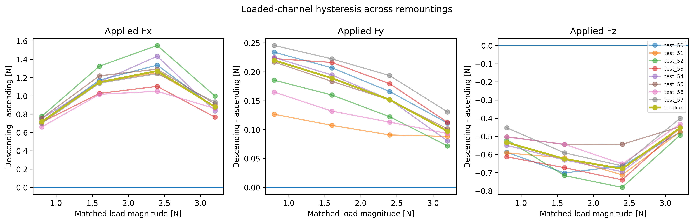

**Result-writing prompt:** state which loaded axis has the largest median/max hysteresis and whether off-axis outputs show comparable history dependence. Do not attribute the effect uniquely to collet friction; the matched-load difference contains the complete assembly/reference response.

## 3. Force transmission and cross-axis coupling

The forward force matrix is fitted on training dwells as `F_measured = B F_delivered + b`, excluding repeated reference dwells so that one direction is not overweighted. The fit itself runs in the EE frame (schema-7 measured channels are already mapped from S), but all quantities below are reported in the raw sensor frame (S); the shaft axis is therefore the "Fz"/"Tz" channel (x_EE, tip on the -x_EE side). An ideal correctly framed, unit-gain force path would have a force block close to the identity. Off-diagonal terms quantify cross-axis coupling of the complete setup.

| output_channel | input_force | unit | mean | median | sd | min | max | n |
| --- | --- | --- | --- | --- | --- | --- | --- | --- |
| Fx | Fx | N/N | 0.8194 | 0.8597 | 0.08083 | 0.7127 | 0.9046 | 8 |
| Fx | Fy | N/N | -1.096 | -1.102 | 0.06195 | -1.19 | -1.023 | 8 |
| Fx | Fz | N/N | -0.04113 | -0.04364 | 0.00904 | -0.05189 | -0.0286 | 8 |
| Fy | Fx | N/N | -0.3074 | -0.3089 | 0.01713 | -0.3264 | -0.2852 | 8 |
| Fy | Fy | N/N | 0.1473 | 0.1528 | 0.01702 | 0.117 | 0.1628 | 8 |
| Fy | Fz | N/N | 0.04399 | 0.04466 | 0.002926 | 0.03897 | 0.04806 | 8 |
| Fz | Fx | N/N | -0.000571 | 0.003567 | 0.0266 | -0.0395 | 0.04593 | 8 |
| Fz | Fy | N/N | 0.5563 | 0.5565 | 0.02638 | 0.5202 | 0.6042 | 8 |
| Fz | Fz | N/N | 0.8343 | 0.8336 | 0.01184 | 0.8135 | 0.849 | 8 |

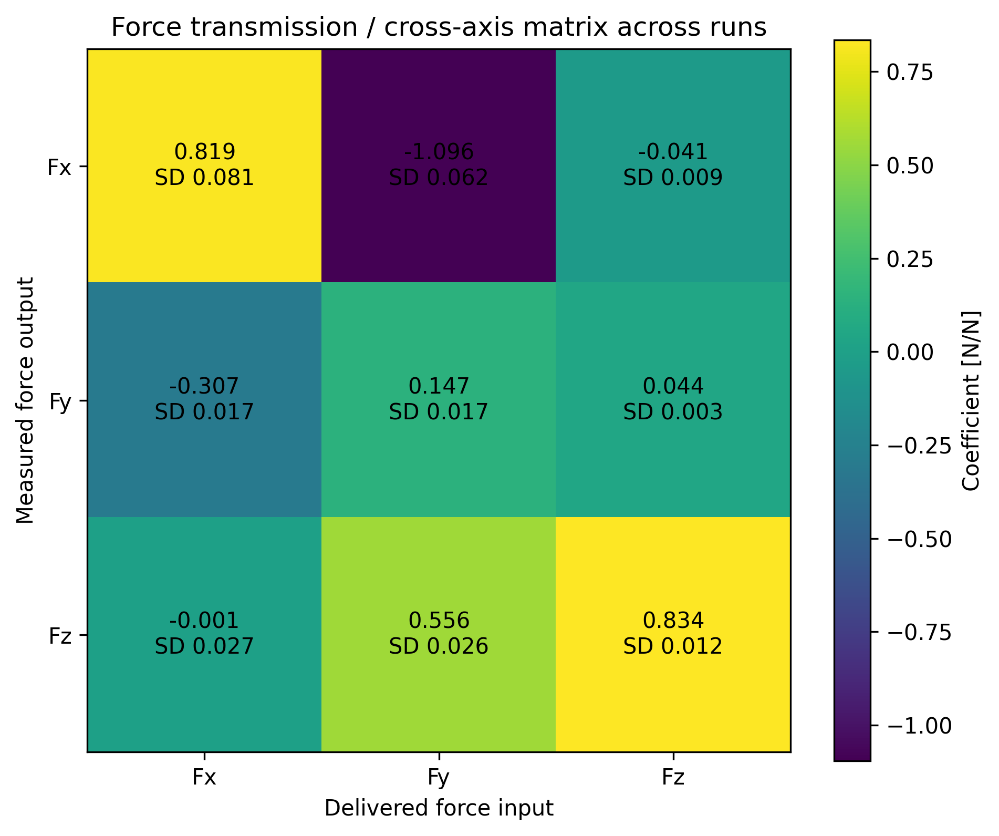

### 3.1 Descriptive polar decomposition of the force block

The 3x3 force block is decomposed into a nearest rotation-like part and a symmetric gain/shear-like part. This is useful for testing whether a simple frame/gain error is plausible, but it does **not** separate sensor intrinsic crosstalk from mounting/frame effects.

| run_id | rotation_angle_deg | gain_like_x | gain_like_y | gain_like_z | force_matrix_residual_pooled_rmse_N |
| --- | --- | --- | --- | --- | --- |
| test_50 | 46.51 | 0.421 | 0.9821 | 0.727 | 0.375 |
| test_51 | 43.31 | 0.609 | 0.8661 | 0.6938 | 0.3339 |
| test_52 | 43.92 | 0.579 | 0.9045 | 0.6783 | 0.383 |
| test_53 | 47.09 | 0.4012 | 1.031 | 0.7209 | 0.3823 |
| test_54 | 45.5 | 0.4 | 0.9225 | 0.7318 | 0.3965 |
| test_55 | 43.28 | 0.545 | 0.9819 | 0.7457 | 0.3557 |
| test_56 | 44.97 | 0.5229 | 1.027 | 0.739 | 0.3253 |
| test_57 | 41.32 | 0.5742 | 0.9158 | 0.7555 | 0.3612 |

### 3.2 Force-to-moment coupling

Because the experiment is force-only, measured moments can still respond strongly through the lever arm. These coefficients are therefore reported as force-to-moment coupling [Nmm/N], not as moment-channel crosstalk in the metrological sense.

| output_channel | input_force | unit | mean | median | sd | min | max | n |
| --- | --- | --- | --- | --- | --- | --- | --- | --- |
| Tx | Fx | Nmm/N | -5.289 | -1.602 | 12.03 | -21.15 | 7.463 | 8 |
| Tx | Fy | Nmm/N | -211.4 | -211.1 | 7.82 | -224.2 | -202.2 | 8 |
| Tx | Fz | Nmm/N | 0.4033 | 0.4581 | 1.224 | -1.935 | 1.677 | 8 |
| Ty | Fx | Nmm/N | 174.6 | 174.2 | 7.742 | 165.9 | 188 | 8 |
| Ty | Fy | Nmm/N | 14.35 | 14.69 | 10.92 | -1.467 | 34.81 | 8 |
| Ty | Fz | Nmm/N | -10.45 | -10.44 | 1.427 | -12.19 | -7.67 | 8 |
| Tz | Fx | Nmm/N | 4.729 | 4.699 | 0.3691 | 4.025 | 5.134 | 8 |
| Tz | Fy | Nmm/N | 4.089 | 4.195 | 0.388 | 3.426 | 4.676 | 8 |
| Tz | Fz | Nmm/N | -0.3768 | -0.3835 | 0.07724 | -0.4808 | -0.2331 | 8 |

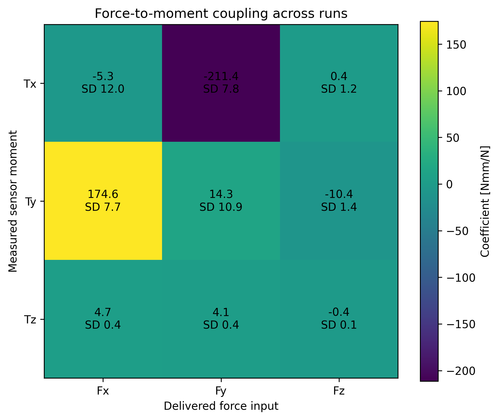

**Suggested thesis placement:** Results §4.2; Discussion §5.2 for interpretation as gain/crosstalk/frame rotation.

## 4. Within-session anchor drift

Anchor drift is evaluated from the three fixed reference anchors within each session. The first anchor is used as the zero for the figure; the table summarises componentwise slopes and spans across runs.

| channel | median_abs_slope_N_per_h | sd_slope_N_per_h | median_span_N | max_span_N | n_runs |
| --- | --- | --- | --- | --- | --- |
| Fx | 1.505 | 0.7411 | 0.3366 | 0.6564 | 8 |
| Fy | 1.149 | 0.2248 | 0.2556 | 0.2928 | 8 |
| Fz | 0.8698 | 0.7585 | 0.4749 | 0.6039 | 8 |

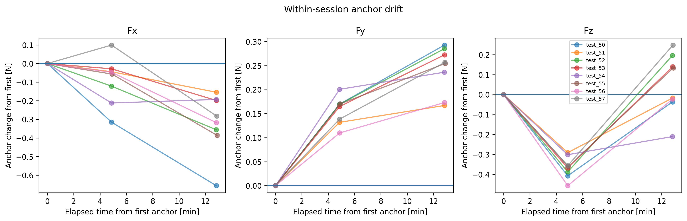

**Suggested thesis placement:** Results §4.4. Report the span as a directly observed within-session change; treat the three-point slope only as a coarse descriptor.

## 5. Residual versus load magnitude

For each Test A/B dwell, the residual shown is the RMS of the three force-component residuals for that dwell. Linear fits are first calculated separately per run and then summarised across runs; this keeps remounting as the independent replication level.

| model | median_intercept_N | sd_intercept_N | median_slope_N_per_N | sd_slope_N_per_N | median_r2 | n_runs |
| --- | --- | --- | --- | --- | --- | --- |
| D1 | -0.8143 | 0.2234 | 0.475 | 0.1044 | 0.4745 | 8 |
| D2 | 0.343 | 0.07564 | 0.02356 | 0.01371 | 0.04258 | 8 |
| P0 | -0.374 | 0.08196 | 0.5353 | 0.02236 | 0.3096 | 8 |
| P1 | 0.04315 | 0.09362 | 0.2413 | 0.02594 | 0.4466 | 8 |
| P2 | 0.04138 | 0.09069 | 0.2424 | 0.02477 | 0.4446 | 8 |
| PA0 | 0.228 | 0.1014 | 0.05595 | 0.02259 | 0.1415 | 8 |
| PA1 | 0.3681 | 0.0808 | 0.02224 | 0.01511 | 0.03943 | 8 |
| PA2 | 0.1827 | 0.05997 | 0.085 | 0.01373 | 0.3195 | 8 |

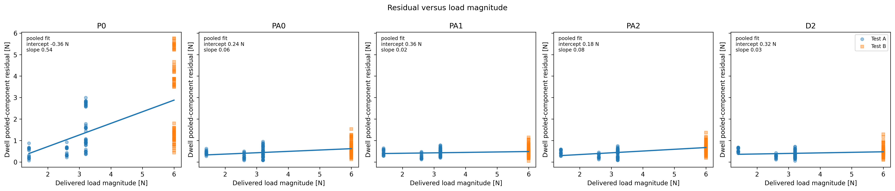

**Result-writing prompt:** a positive intercept is descriptive evidence for a load-independent error component; a positive slope indicates an additional load-dependent component. Do not interpret the intercept as a unique physical mechanism without the drift/hysteresis evidence.

## 6. Apparent EI versus handbook EI

Handbook EI used by the compliant model: **1.2013 N m²**.

Apparent EI is calculated independently from the reconstruction models by fitting end-effector lateral displacement against delivered lateral load on isolated Fx/Fy staircase dwells and applying the free-cantilever relation `delta = F L^3/(3 EI)` with the declared unsupported length. This does **not** fit EI for P2/PA2.

| axis | median_EI_apparent_Nm2 | sd_EI_apparent_Nm2 | median_ratio_to_handbook | median_fit_r2 | n_runs |
| --- | --- | --- | --- | --- | --- |
| Fx | 1.896 | 0.1096 | 1.579 | 0.9386 | 8 |
| Fy | 1.855 | 0.0763 | 1.544 | 0.9379 | 8 |

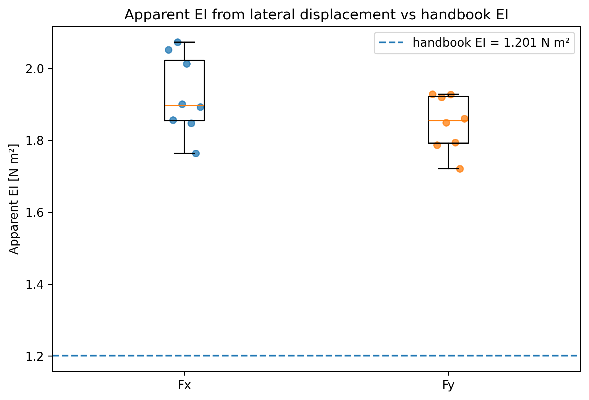

> **Interpretation limit:** `p_relative_*_EE` (reported above under its sensor-frame axis labels) is Lambda.7 end-effector displacement. The inferred compliance can include the distal adapter, coupling, haptic-device behaviour, frame error and shaft bending. Therefore this is an apparent system EI / consistency check, not a material-property measurement.

**Suggested thesis placement:** Results §4.2 or an appendix diagnostic; Discussion §5.4 for the compliance hypothesis.

## 7. Dwell-mean delivered versus predicted forces

The following pooled table uses all Test A/B run-dwells for visualization. The models themselves were fitted independently within each run on training data only.

| model | evaluation | pooled_rmse_N | residual_sd_N | pooled_r2 | n_run_dwells | n_runs |
| --- | --- | --- | --- | --- | --- | --- |
| D1 | Test A | 0.5201 | 0.4853 | 0.8971 | 80 | 8 |
| D1 | Test B | 2.699 | 2.623 | 0.3846 | 80 | 8 |
| D2 | Test A | 0.4064 | 0.3655 | 0.9372 | 80 | 8 |
| D2 | Test B | 0.5403 | 0.5233 | 0.9753 | 80 | 8 |
| P0 | Test A | 1.435 | 1.408 | 0.2164 | 80 | 8 |
| P0 | Test B | 3.373 | 3.31 | 0.03918 | 80 | 8 |
| P1 | Test A | 0.8365 | 0.8344 | 0.7339 | 80 | 8 |
| P1 | Test B | 1.613 | 1.591 | 0.7802 | 80 | 8 |
| P2 | Test A | 0.84 | 0.8376 | 0.7316 | 80 | 8 |
| P2 | Test B | 1.62 | 1.592 | 0.7785 | 80 | 8 |
| PA0 | Test A | 0.4566 | 0.3659 | 0.9207 | 80 | 8 |
| PA0 | Test B | 0.6943 | 0.6759 | 0.9593 | 80 | 8 |
| PA1 | Test A | 0.4507 | 0.3799 | 0.9227 | 80 | 8 |
| PA1 | Test B | 0.5378 | 0.5291 | 0.9756 | 80 | 8 |
| PA2 | Test A | 0.4249 | 0.3737 | 0.9313 | 80 | 8 |
| PA2 | Test B | 0.7265 | 0.7279 | 0.9554 | 80 | 8 |

### P0: Direct-force equilibrium

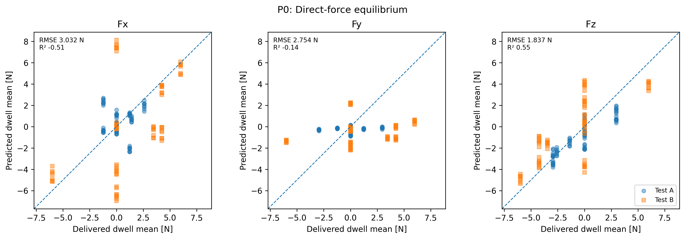

### P1: Fixed-lever moment model

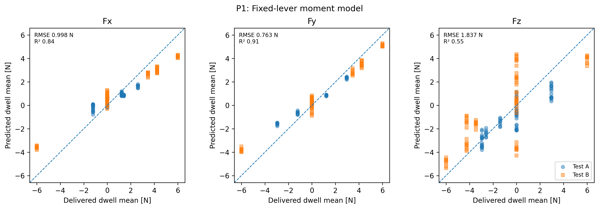

### P2: Compliant-lever moment model

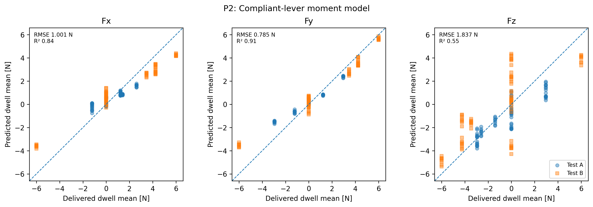

### PA0: Affine direct-force model

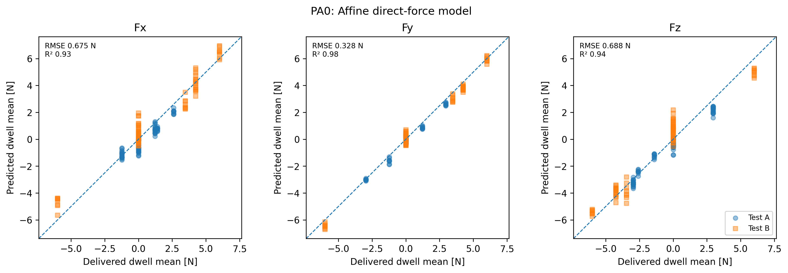

### PA1: Affine fixed-lever model

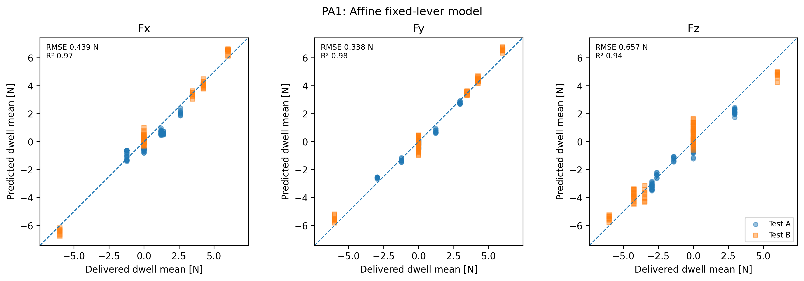

### PA2: Affine compliant-lever model

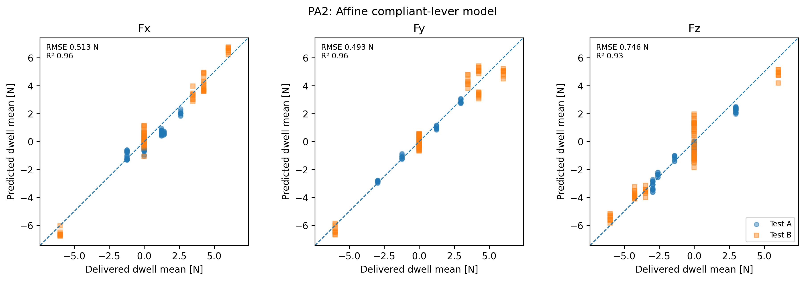

### D1: Quadratic regression

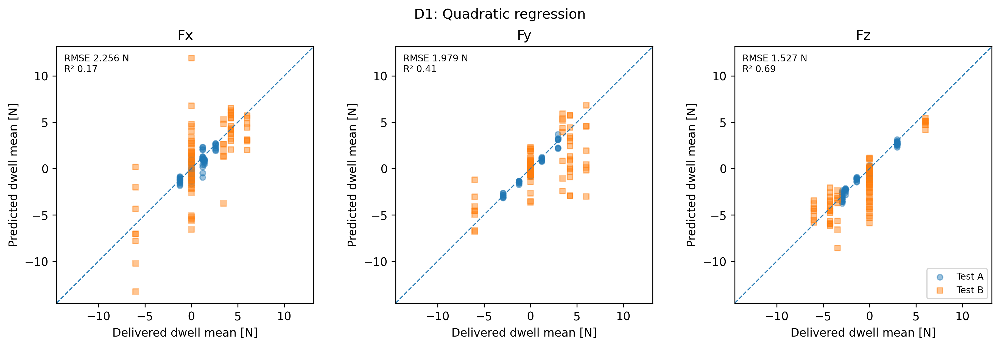

### D2: Multilayer perceptron

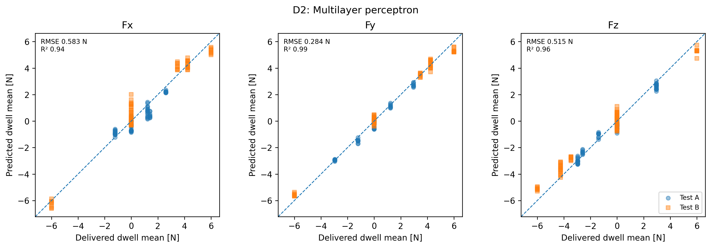

## 8. Thesis-facing checklist

Use this diagnostic report to support the following factual statements only after checking the generated tables:

- whether the force transmission matrix is predominantly linear and whether off-diagonal terms are stable across remountings;
- whether a rotation/gain-like decomposition is consistent across runs;
- which axes show the largest matched-load hysteresis and anchor drift;
- whether PA0/D2 residuals contain a substantial non-zero intercept as load approaches zero;
- whether the apparent EI estimate is remotely consistent with handbook EI, while preserving the caveat that the displacement is system-level;
- whether delivered-versus-predicted parity reveals channel-specific compression, offset, saturation or extrapolation error.

These diagnostics do not establish traceable absolute accuracy, distal-moment accuracy, or trocar-condition performance.