# Thesis Results Skeleton — Eight Instrument Remountings

> Automatically generated from the raw run folders. Numerical statements in Sections 4.1–4.5 are data-derived. Interpretive language is intentionally kept in the Discussion hand-off at the end.

**Campaign:** 8 discovered runs. Main accuracy metric: pooled per-axis RMSE, first computed within a run and then summarized across runs. Absolute RMSE is primary; R² is secondary because channel variance differs strongly between test sets.

## 4.1 Dataset and integrity checks

All runs used the same pattern seed: **True** (20260907). The complete Test A + Test B command signature was identical across runs: **True**. Therefore, between-run variation is not caused by different selected test loads.

The ROTATION alignment stage is listed as skipped in **8/8** runs. Explicit ALIGNMENT_FAILED markers were detected in: **test_53**.

The robustness-scale metadata were identical across runs: **True**, with robust_scale_f = **1.50×**.

The firmware-risk moment threshold was set to **800 Nmm**. A 6 N transverse load acting through the nominal 310 mm lever corresponds to **1860 Nmm**. The recorded threshold was crossed in **8/8** runs (test_50, test_51, test_52, test_53, test_54, test_55, test_56, test_57). A threshold crossing is reported as a data-integrity warning; this script does not infer a sign flip merely from exceeding the threshold.

**Run-level audit table**

| run_id | pattern_seed | same_test_signature | alignment_failed | skipped_rotation | moment_max_any_Nmm | rows_over_moment_threshold | deadweight_present | testA_PA0_rmse_N | testA_PA0_pass | testA_D2_rmse_N | testB_PA0_rmse_N | testB_D2_rmse_N | pa0_degradation_x | pa0_degradation_pass |
|---|---|---|---|---|---|---|---|---|---|---|---|---|---|---|
| test_50 | 20260907 | True | False | True | 1562.256 | 14011 | True | 0.476 | True | 0.395 | 0.636 | 0.532 | 1.336 | True |
| test_51 | 20260907 | True | False | True | 1618.973 | 19542 | True | 0.439 | True | 0.336 | 0.628 | 0.464 | 1.431 | True |
| test_52 | 20260907 | True | False | True | 1559.372 | 13892 | True | 0.373 | True | 0.400 | 0.781 | 0.615 | 2.093 | False |
| test_53 | 20260907 | True | True | True | 1576.671 | 20058 | True | 0.449 | True | 0.431 | 0.718 | 0.523 | 1.598 | True |
| test_54 | 20260907 | True | False | True | 1594.382 | 19921 | True | 0.557 | False | 0.431 | 0.691 | 0.568 | 1.242 | True |
| test_55 | 20260907 | True | False | True | 1607.184 | 20212 | True | 0.498 | True | 0.455 | 0.711 | 0.529 | 1.427 | True |
| test_56 | 20260907 | True | False | True | 1647.409 | 20067 | True | 0.393 | True | 0.340 | 0.584 | 0.550 | 1.486 | True |
| test_57 | 20260907 | True | False | True | 1568.289 | 20524 | True | 0.442 | True | 0.446 | 0.780 | 0.528 | 1.765 | True |

**Specific check — test_53.** ALIGNMENT_FAILED = **True**; Test A PA0 RMSE = **0.449 N** (0.5 N pass = **True**); Test B/A PA0 degradation = **1.60×** (2× pass = **True**). This directly tests whether the failed alignment run is also the requirement outlier.

## 4.2 Force reconstruction and model comparison

### 4.2.1 Overall model ranking

Across the 8 remountings, the median Test A pooled RMSE was **1.431 N** for P0, **0.446 N** for PA0, **0.449 N** for PA1, and **0.415 N** for D2. PA0 outperformed P0 in **8/8** paired runs. D2 outperformed PA0 in **6/8** paired runs on Test A; the median paired D2−PA0 difference was **-0.048 N** (run-level bootstrap 95% interval **-0.102 to 0.004 N**).

**Best-model count across the compared candidates**

| evaluation | winner | best_count | n_winner_rows |
|---|---|---|---|
| accuracy | D1 | 1 | 1 |
| accuracy | D2 | 4 | 4 |
| accuracy | PA0 | 1 | 1 |
| accuracy | PA1 | 1 | 1 |
| accuracy | PA2 | 1 | 1 |
| robustness | D2 | 5 | 5 |
| robustness | PA1 | 3 | 3 |

For P0, the median Test A residual SD was **1.433 N**, compared with an RMSE of **1.431 N**. The nominal HEX-32 operating-point accuracy supplied for comparison is **1.25 N**; cite the corresponding datasheet source in the thesis before using this comparison.

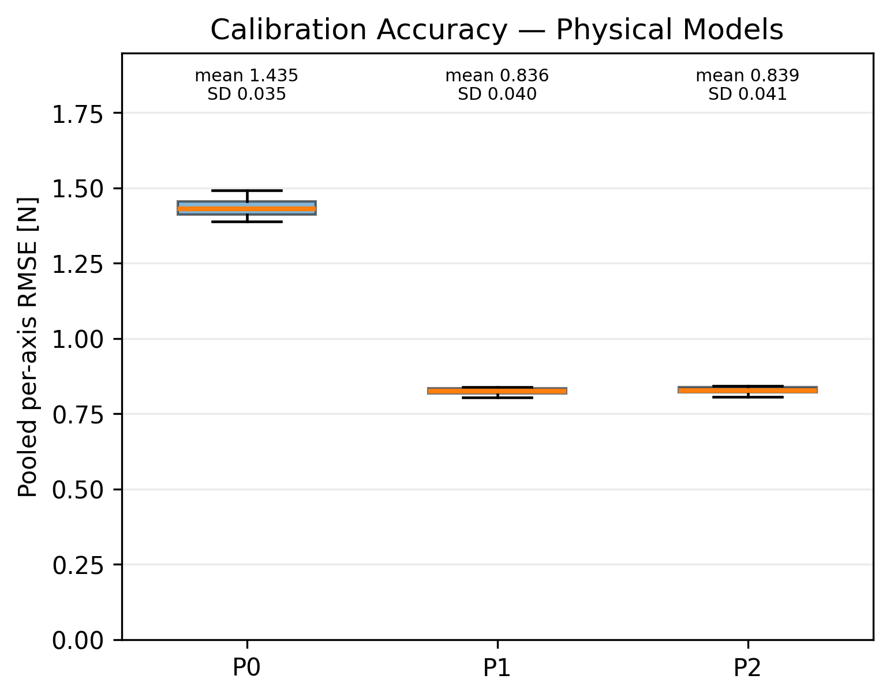

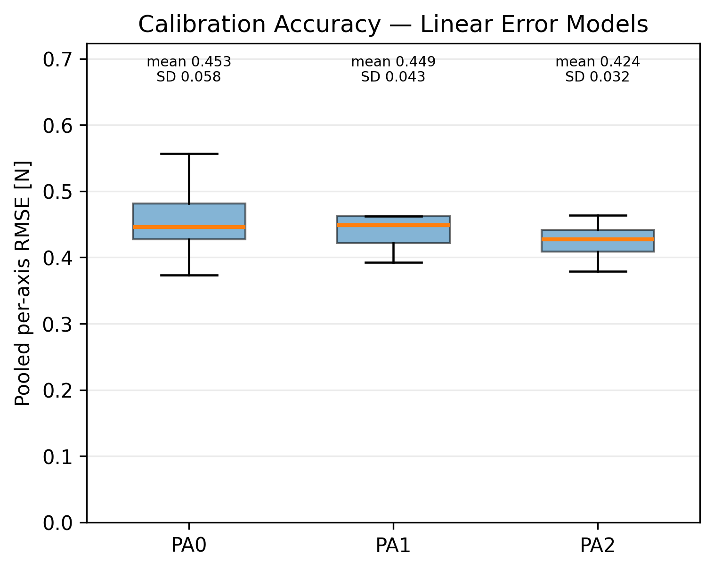

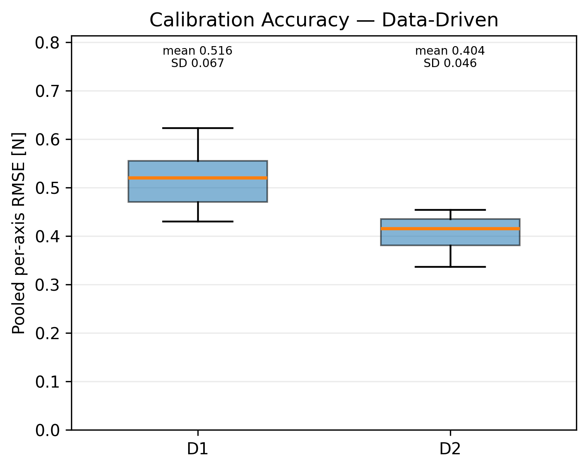

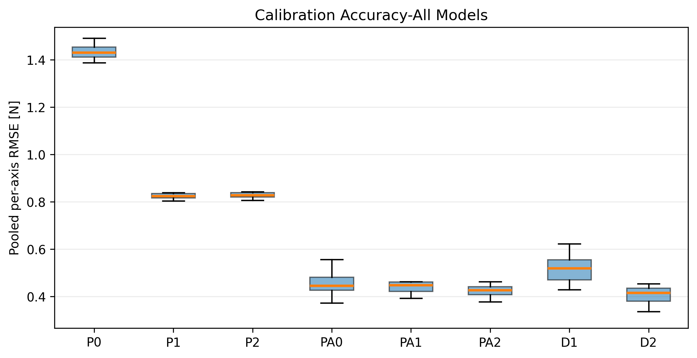

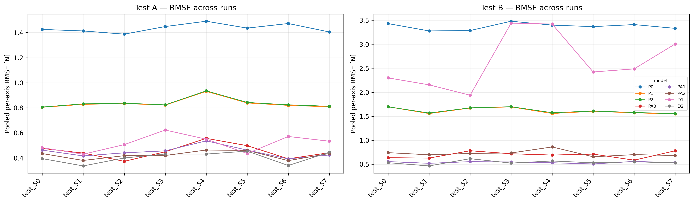

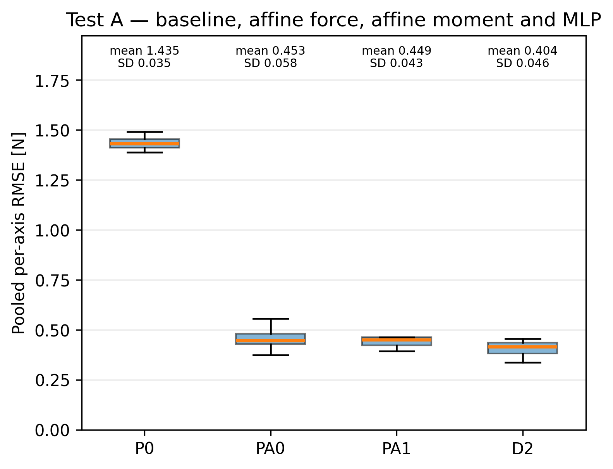

**All-model Test A summary**

| family | model | model_name | n_runs | rmse_median_N | rmse_run_sd_N | normalized_rmse_median_pct | residual_sd_median_N | r2_median |
|---|---|---|---|---|---|---|---|---|
| Data-Driven | D2 | Multilayer perceptron | 8 | 0.415 | 0.046 | 10.384 | 0.380 | 0.934 |
| Linear Error Models | PA2 | Affine compliant-lever model | 8 | 0.427 | 0.032 | 10.684 | 0.384 | 0.931 |
| Linear Error Models | PA0 | Affine direct-force model | 8 | 0.446 | 0.058 | 11.139 | 0.364 | 0.924 |
| Linear Error Models | PA1 | Affine fixed-lever model | 8 | 0.449 | 0.043 | 11.218 | 0.386 | 0.923 |
| Data-Driven | D1 | Quadratic regression | 8 | 0.520 | 0.067 | 12.998 | 0.480 | 0.897 |
| Physical Models | P1 | Fixed-lever moment model | 8 | 0.824 | 0.040 | 20.609 | 0.832 | 0.742 |
| Physical Models | P2 | Compliant-lever moment model | 8 | 0.828 | 0.041 | 20.695 | 0.835 | 0.739 |
| Physical Models | P0 | Direct-force equilibrium | 8 | 1.431 | 0.035 | 35.770 | 1.433 | 0.221 |

### 4.2.2 Affine correction and PA0 matrix decomposition

The 3×3 force-input block of PA0 was converted back to physical (unstandardized) coefficients and decomposed as A = R S. The median residual rotation angle was **53.56°**. Median stretch/gain terms were Fx **2.785**, Fy **10.639**, and Fz **1.084**. The independently observed Fy gain supplied for comparison is **0.83**. Because PA0 also includes the three moment channels, this polar decomposition applies only to its force-input sub-block with moment features held fixed; it is a diagnostic, not a unique decomposition of the full 3×6 map.

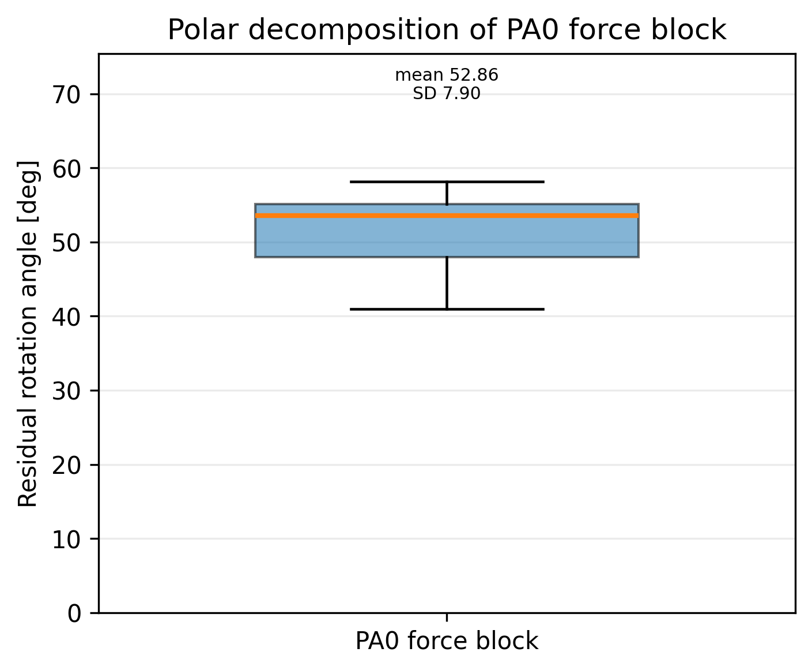

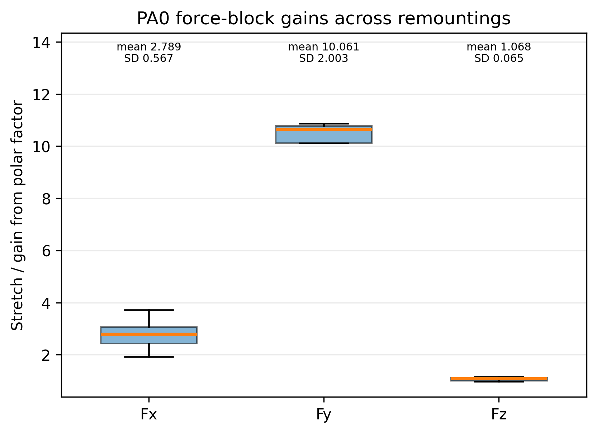

| run_id | rotation_angle_deg | det_rotation | gain_x | gain_y | gain_z | gain_y_minus_known | force_block_offdiag_fro | moment_block_fro_N_per_Nmm | intercept_norm_N |
|---|---|---|---|---|---|---|---|---|---|
| test_50 | 54.092 | 1.000 | 2.737 | 10.734 | 1.111 | 9.904 | 10.822 | 0.046 | 0.817 |
| test_51 | 53.120 | 1.000 | 2.456 | 10.463 | 1.153 | 9.633 | 10.651 | 0.076 | 1.015 |
| test_52 | 58.156 | 1.000 | 2.976 | 10.871 | 1.125 | 10.041 | 11.197 | 0.082 | 0.897 |
| test_53 | 54.006 | 1.000 | 2.346 | 9.064 | 0.982 | 8.234 | 9.060 | 0.063 | 1.556 |
| test_54 | 67.309 | 1.000 | 2.833 | 10.574 | 0.994 | 9.744 | 11.080 | 0.085 | 1.482 |
| test_55 | 48.389 | 1.000 | 3.328 | 10.705 | 1.080 | 9.875 | 10.497 | 0.063 | 1.082 |
| test_56 | 40.986 | 1.000 | 1.920 | 5.642 | 1.009 | 4.812 | 4.926 | 0.047 | 1.193 |
| test_57 | 46.820 | 1.000 | 3.716 | 12.431 | 1.088 | 11.601 | 12.240 | 0.101 | 0.904 |

**TODO for the thesis:** connect this diagnostic to the independent Fy gain / Tx cross-talk characterization and verify the controller-side `a_ee_to_sensor` implementation from source code. The CSV itself cannot prove that a source-code matrix was an identity placeholder.

### 4.2.3 Effect of shaft compliance

At a 6 N transverse load, the magnitude of the assumed deformed lever x-component changes from **310.0 mm** to **307.1 mm** under the handbook-EI model. The paired compliant-minus-fixed Test A RMSE difference is **4.1 mN** for P2−P1 and **-25.0 mN** for PA2−PA1. On Test B the corresponding differences are **4.7 mN** and **174.5 mN**. Positive values mean the compliant variant is worse.

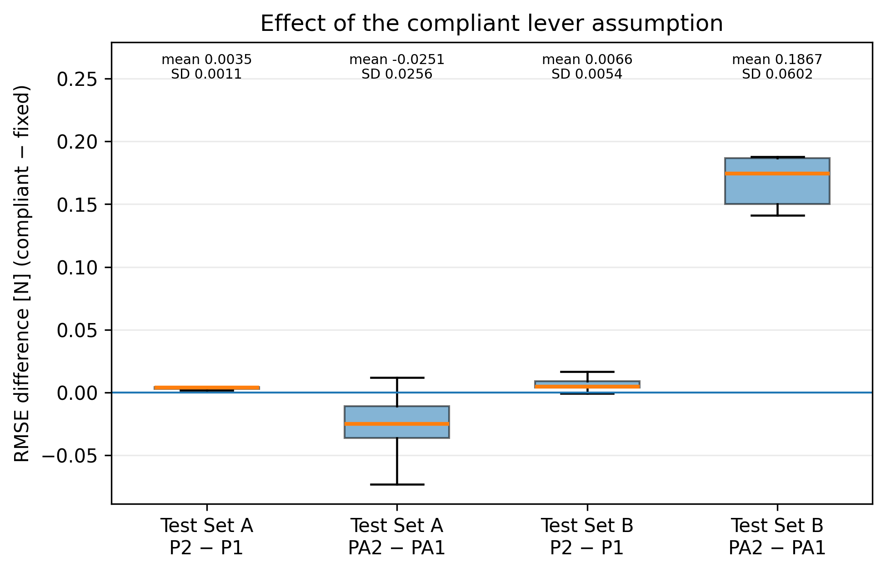

### 4.2.4 Axial observability and direct-Fx moment models

Bending moments cannot observe force parallel to the shaft because r ∥ F produces no bending moment. In these recordings the sensor-to-tip lever is along -x_EE, so P1 and P2 take Fx_EE directly from the sensor force channel by construction; Fy_EE is reconstructed from -Tz_EE/L and Fz_EE from +Ty_EE/L. PA1 and PA2 apply the same six-input affine calibration to these physically completed force estimates plus the measured sensor moments.

| model | force_channel | rmse_N | r2 |
|---|---|---|---|
| PA1 | Fx | 0.546 | 0.772 |
| PA1 | Fy | 0.290 | 0.959 |
| PA1 | Fz | 0.498 | 0.941 |
| PA2 | Fx | 0.546 | 0.773 |
| PA2 | Fy | 0.171 | 0.986 |
| PA2 | Fz | 0.480 | 0.945 |

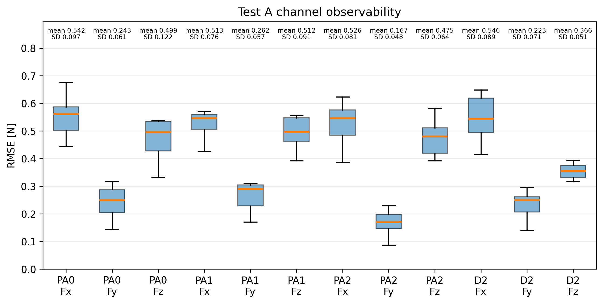

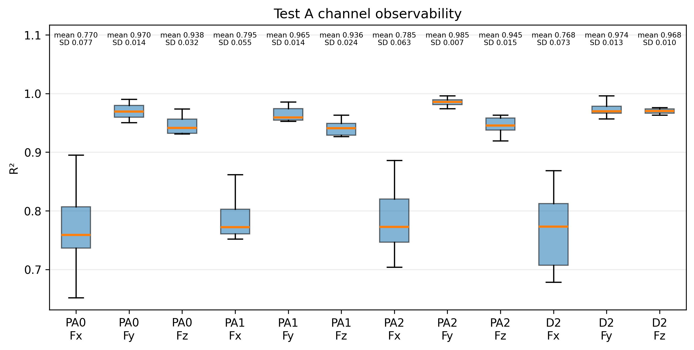

### 4.2.5 Worst-case held-out dwell errors

The table below reports the single largest force-vector error per model and held-out test set, preserving the run and pattern identifier. This fills the worst-case-per-dwell item that was missing from the previous Results draft.

| model | evaluation | run_id | pattern_index | pattern_label | vector_error_N | max_component_error_N | err_Fx_N | err_Fy_N | err_Fz_N |
|---|---|---|---|---|---|---|---|---|---|
| P0 | Test A | test_56 | 92 | offgrid_YZ_-1@0.80 | 5.182 | 3.905 | 3.905 | 2.662 | -2.126 |
| P2 | Test A | test_54 | 92 | offgrid_YZ_-1@0.80 | 2.780 | 2.143 | 0.865 | 1.545 | -2.143 |
| P1 | Test A | test_54 | 92 | offgrid_YZ_-1@0.80 | 2.739 | 2.143 | 0.849 | 1.480 | -2.143 |
| D1 | Test A | test_56 | 91 | offgrid_YZ_+1@0.80 | 2.330 | 2.186 | -2.186 | -0.799 | -0.083 |
| PA0 | Test A | test_54 | 93 | offgrid_XY_-1@0.80 | 1.645 | 1.357 | -0.927 | -0.072 | -1.357 |
| PA1 | Test A | test_54 | 93 | offgrid_XY_-1@0.80 | 1.352 | 1.225 | -0.566 | 0.086 | -1.225 |
| PA2 | Test A | test_55 | 93 | offgrid_XY_-1@0.80 | 1.298 | 0.940 | -0.940 | -0.032 | -0.895 |
| D2 | Test A | test_55 | 85 | offgrid_XZ_+1@0.80 | 1.250 | 1.084 | -1.084 | -0.621 | -0.054 |
| D1 | Test B | test_54 | 97 | Fy-@1.50_robust | 13.468 | 11.900 | 11.900 | 4.783 | -4.113 |
| P0 | Test B | test_53 | 97 | Fy-@1.50_robust | 9.978 | 8.121 | 8.121 | 4.497 | -3.659 |
| P2 | Test B | test_54 | 97 | Fy-@1.50_robust | 4.999 | 4.287 | 0.255 | 2.558 | -4.287 |
| P1 | Test B | test_54 | 97 | Fy-@1.50_robust | 4.848 | 4.287 | 0.280 | 2.246 | -4.287 |
| PA0 | Test B | test_52 | 104 | Fz-@1.50_robust | 2.652 | 2.179 | 1.464 | 0.379 | 2.179 |
| PA2 | Test B | test_54 | 96 | Fy+@1.50_robust | 2.369 | 1.866 | -1.058 | -1.005 | -1.866 |
| D2 | Test B | test_52 | 99 | diag_XY@1.50_robust | 2.233 | 2.011 | 2.011 | 0.448 | 0.859 |
| PA1 | Test B | test_52 | 104 | Fz-@1.50_robust | 1.983 | 1.666 | -0.619 | -0.879 | 1.666 |

## 4.3 Independent dead-weight validation

Independent dead-weight files were found for **8/8** runs. These measurements do not use the Lambda.7 reference and are therefore reported separately from Test A/Test B.

| run_id | model | expected_force_N | magnitude_N | absolute_error_N | rel_error_pct |
|---|---|---|---|---|---|
| test_50 | sensor_raw | 1.471 | 1.741 | 0.270 | 18.373 |
| test_50 | P0 | 1.471 | 1.741 | 0.270 | 18.373 |
| test_50 | P1 | 1.471 | 1.769 | 0.298 | 20.285 |
| test_50 | P2 | 1.471 | 1.777 | 0.306 | 20.804 |
| test_50 | PA0 | 1.471 | 1.522 | 0.051 | 3.493 |
| test_50 | PA1 | 1.471 | 3.118 | 1.647 | 111.946 |
| test_50 | PA2 | 1.471 | 3.133 | 1.662 | 113.005 |
| test_50 | D1 | 1.471 | 5.309 | 3.838 | 260.885 |
| test_50 | D2 | 1.471 | 2.941 | 1.470 | 99.962 |
| test_51 | sensor_raw | 1.471 | 1.707 | 0.236 | 16.035 |
| test_51 | P0 | 1.471 | 1.707 | 0.236 | 16.035 |
| test_51 | P1 | 1.471 | 1.593 | 0.122 | 8.286 |
| test_51 | P2 | 1.471 | 1.583 | 0.112 | 7.583 |
| test_51 | PA0 | 1.471 | 0.710 | 0.761 | -51.746 |
| test_51 | PA1 | 1.471 | 2.614 | 1.143 | 77.700 |
| test_51 | PA2 | 1.471 | 2.620 | 1.149 | 78.123 |
| test_51 | D1 | 1.471 | 4.660 | 3.189 | 216.807 |
| test_51 | D2 | 1.471 | 2.398 | 0.927 | 63.015 |
| test_52 | sensor_raw | 1.471 | 1.892 | 0.421 | 28.611 |
| test_52 | P0 | 1.471 | 1.892 | 0.421 | 28.611 |
| test_52 | P1 | 1.471 | 1.711 | 0.240 | 16.299 |
| test_52 | P2 | 1.471 | 1.707 | 0.236 | 16.048 |
| test_52 | PA0 | 1.471 | 1.370 | 0.101 | -6.852 |
| test_52 | PA1 | 1.471 | 2.925 | 1.454 | 98.869 |
| test_52 | PA2 | 1.471 | 2.936 | 1.465 | 99.615 |
| test_52 | D1 | 1.471 | 4.087 | 2.616 | 177.843 |
| test_52 | D2 | 1.471 | 2.866 | 1.395 | 94.823 |
| test_53 | sensor_raw | 1.471 | 1.767 | 0.296 | 20.134 |
| test_53 | P0 | 1.471 | 1.767 | 0.296 | 20.134 |
| test_53 | P1 | 1.471 | 1.729 | 0.258 | 17.561 |
| test_53 | P2 | 1.471 | 1.733 | 0.262 | 17.780 |
| test_53 | PA0 | 1.471 | 1.915 | 0.444 | 30.171 |
| test_53 | PA1 | 1.471 | 2.867 | 1.396 | 94.914 |
| test_53 | PA2 | 1.471 | 2.868 | 1.397 | 94.952 |
| test_53 | D1 | 1.471 | 11.870 | 10.399 | 706.958 |
| test_53 | D2 | 1.471 | 2.643 | 1.172 | 79.653 |
| test_54 | sensor_raw | 1.471 | 1.791 | 0.320 | 21.732 |
| test_54 | P0 | 1.471 | 1.791 | 0.320 | 21.732 |
| test_54 | P1 | 1.471 | 1.701 | 0.230 | 15.615 |
| test_54 | P2 | 1.471 | 1.688 | 0.217 | 14.719 |
| test_54 | PA0 | 1.471 | 1.956 | 0.485 | 33.004 |
| test_54 | PA1 | 1.471 | 2.993 | 1.522 | 103.434 |
| test_54 | PA2 | 1.471 | 3.082 | 1.611 | 109.515 |
| test_54 | D1 | 1.471 | 2.639 | 1.168 | 79.378 |
| test_54 | D2 | 1.471 | 3.119 | 1.648 | 112.004 |
| test_55 | sensor_raw | 1.471 | 1.824 | 0.353 | 23.967 |
| test_55 | P0 | 1.471 | 1.824 | 0.353 | 23.967 |
| test_55 | P1 | 1.471 | 1.676 | 0.205 | 13.960 |
| test_55 | P2 | 1.471 | 1.675 | 0.204 | 13.862 |
| test_55 | PA0 | 1.471 | 0.826 | 0.645 | -43.874 |
| test_55 | PA1 | 1.471 | 2.854 | 1.383 | 94.004 |
| test_55 | PA2 | 1.471 | 2.838 | 1.367 | 92.916 |
| test_55 | D1 | 1.471 | 2.802 | 1.331 | 90.496 |
| test_55 | D2 | 1.471 | 2.712 | 1.241 | 84.356 |
| test_56 | sensor_raw | 1.471 | 1.778 | 0.307 | 20.895 |
| test_56 | P0 | 1.471 | 1.778 | 0.307 | 20.895 |
| test_56 | P1 | 1.471 | 1.607 | 0.136 | 9.272 |
| test_56 | P2 | 1.471 | 1.602 | 0.131 | 8.892 |
| test_56 | PA0 | 1.471 | 1.861 | 0.390 | 26.534 |
| test_56 | PA1 | 1.471 | 2.629 | 1.158 | 78.709 |
| test_56 | PA2 | 1.471 | 2.629 | 1.158 | 78.691 |
| test_56 | D1 | 1.471 | 5.332 | 3.861 | 262.487 |
| test_56 | D2 | 1.471 | 2.350 | 0.879 | 59.765 |
| test_57 | sensor_raw | 1.471 | 1.921 | 0.450 | 30.576 |
| test_57 | P0 | 1.471 | 1.921 | 0.450 | 30.576 |
| test_57 | P1 | 1.471 | 1.642 | 0.171 | 11.621 |
| test_57 | P2 | 1.471 | 1.645 | 0.174 | 11.812 |
| test_57 | PA0 | 1.471 | 0.359 | 1.112 | -75.627 |
| test_57 | PA1 | 1.471 | 2.758 | 1.287 | 87.520 |
| test_57 | PA2 | 1.471 | 2.750 | 1.279 | 86.951 |
| test_57 | D1 | 1.471 | 3.212 | 1.741 | 118.358 |
| test_57 | D2 | 1.471 | 2.650 | 1.179 | 80.180 |

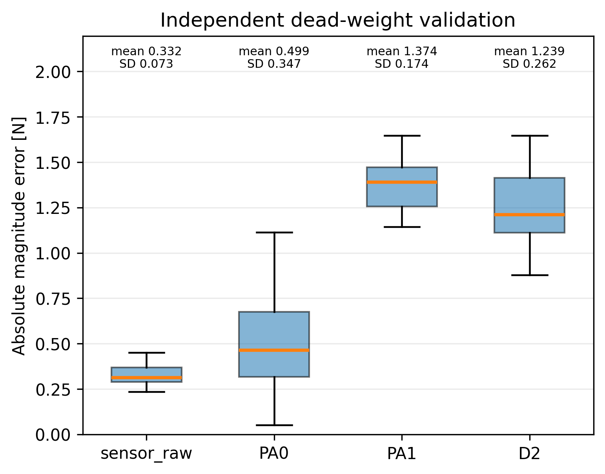

## 4.4 Repeatability and remounting

### 4.4.1 Within-session repeated-dwell scatter

| force_channel | n_runs | median_N | run_sd_N | min_N | max_N |
|---|---|---|---|---|---|
| Fx | 8 | 0.137 | 0.049 | 0.060 | 0.226 |
| Fy | 8 | 0.043 | 0.008 | 0.033 | 0.056 |
| Fz | 8 | 0.179 | 0.018 | 0.175 | 0.221 |

The median pooled component repeatability scale (root-mean-square of the three channel SDs within each run) is **0.136 N**. The axial Fx SD is **0.137 N**, versus transverse Fy **0.043 N** and Fz **0.179 N**.

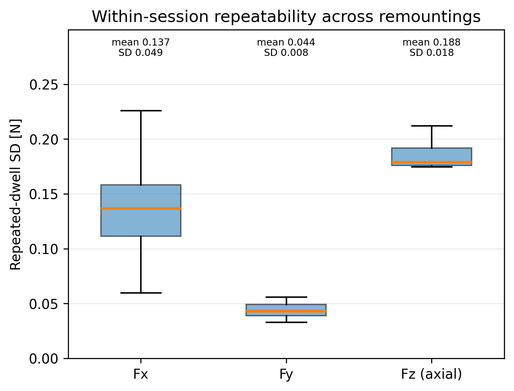

### 4.4.2 Between-remounting spread

| group | channel | n_patterns | b_prime_sd_median | b_prime_sd_p95 | b_prime_range_max |
|---|---|---|---|---|---|
| instrument | Fx_meas_S_N | 106 | 0.227 | 0.437 | 1.439 |
| instrument | Fy_meas_S_N | 106 | 0.060 | 0.118 | 0.435 |
| instrument | Fz_meas_S_N | 106 | 0.246 | 0.332 | 1.142 |

### 4.4.3 Calibration transfer without refitting

| group | model | n_source_runs | same_run_rmse_median_N | cross_run_rmse_median_N | transfer_penalty_median_x | transfer_penalty_q25_x | transfer_penalty_q75_x | transfer_penalty_ci95_median_lo_x | transfer_penalty_ci95_median_hi_x |
|---|---|---|---|---|---|---|---|---|---|
| instrument | PA1 | 8 | 0.449 | 0.464 | 1.046 | 1.021 | 1.156 | 0.997 | 1.292 |
| instrument | D2 | 8 | 0.415 | 0.489 | 1.219 | 1.174 | 1.276 | 1.096 | 1.314 |
| instrument | PA0 | 8 | 0.446 | 0.595 | 1.288 | 1.160 | 1.469 | 1.148 | 1.701 |
| instrument | D1 | 8 | 0.520 | 1.241 | 2.351 | 2.119 | 3.614 | 2.084 | 4.045 |

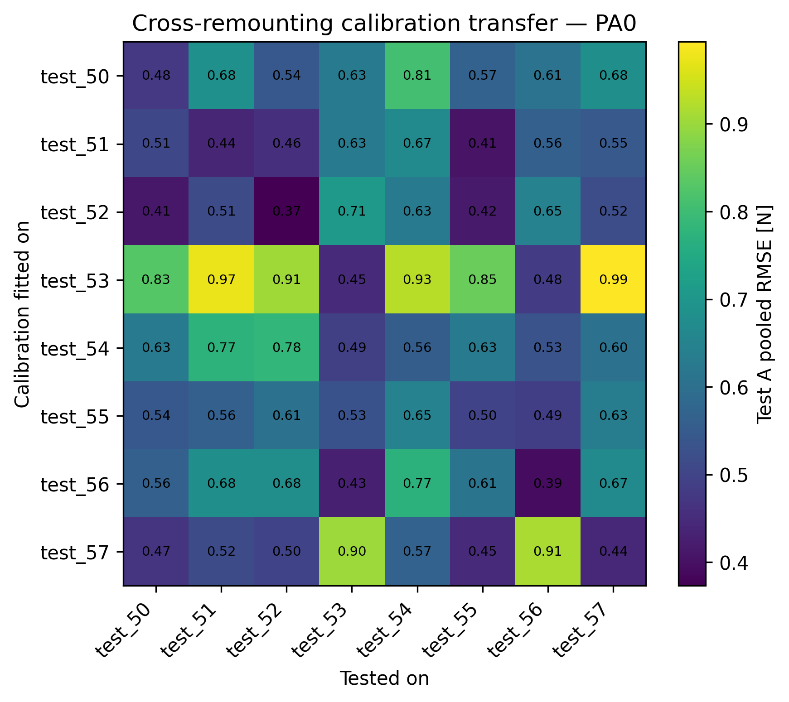

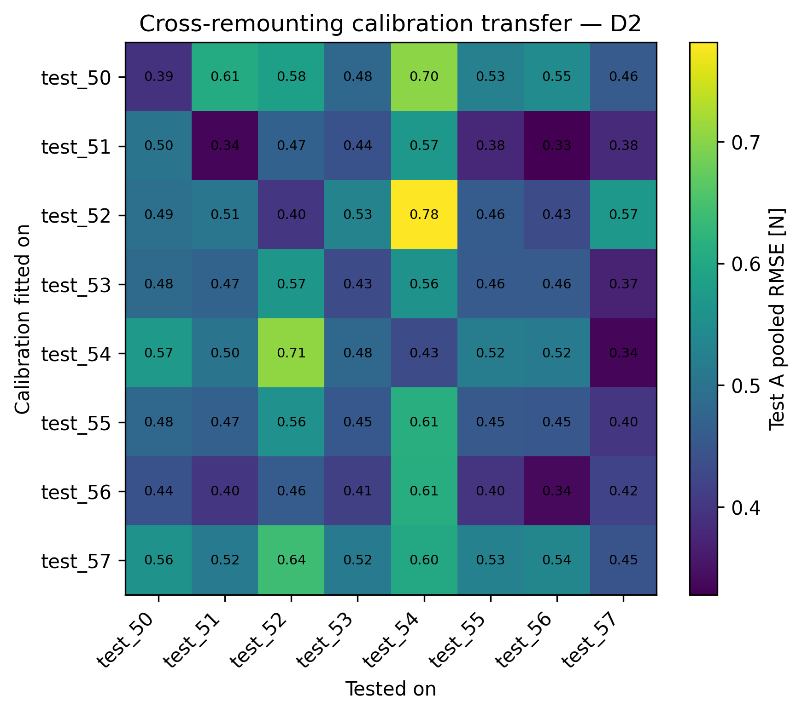

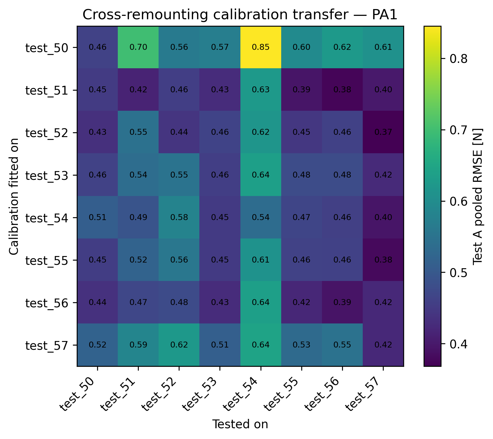

For PA0, the median same-run Test A RMSE is **0.446 N** and the median cross-remounting RMSE is **0.595 N**, corresponding to a transfer penalty of **1.29×**. Relative to the declared **0.50 N** requirement, the cross-remounting result is above the threshold.

## 4.5 Robustness and extrapolation

Test B uses a robustness scale of **1.50×** relative to the nominal training amplitude. Median Test B pooled RMSE is PA0 **0.701 N**, D2 **0.531 N**, and PA1 **0.539 N**. D2 outperformed PA0 in **8/8** paired Test B runs.

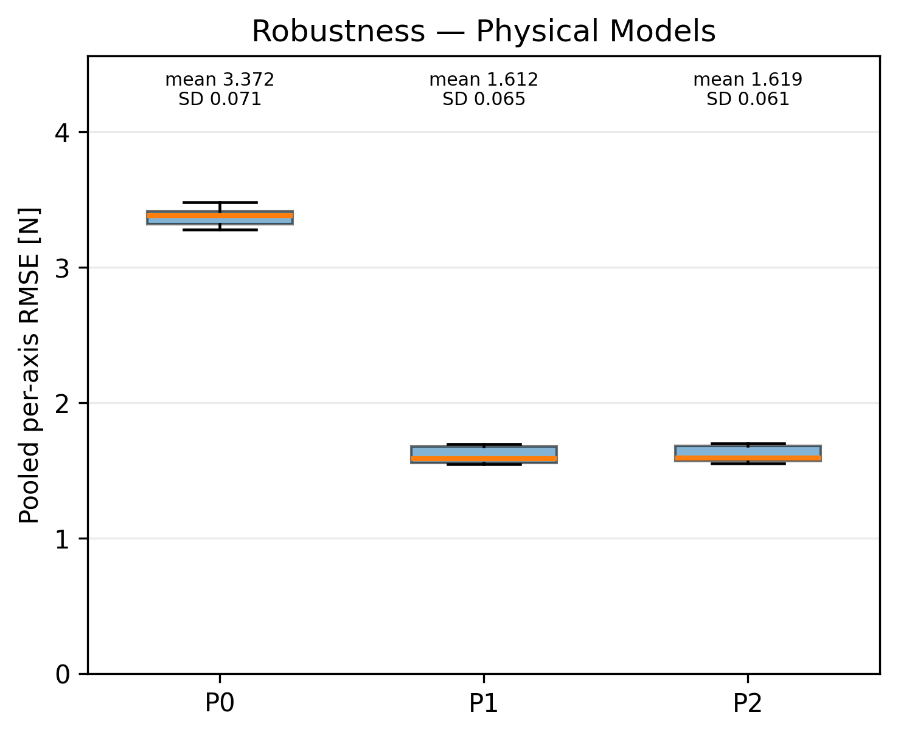

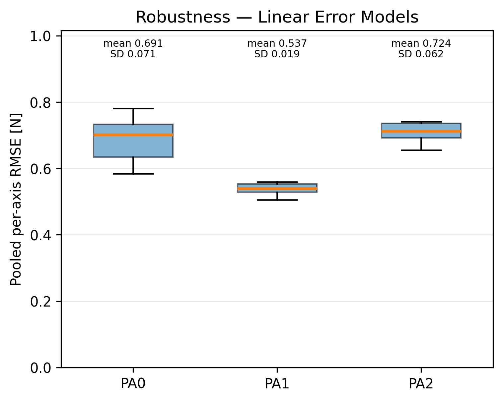

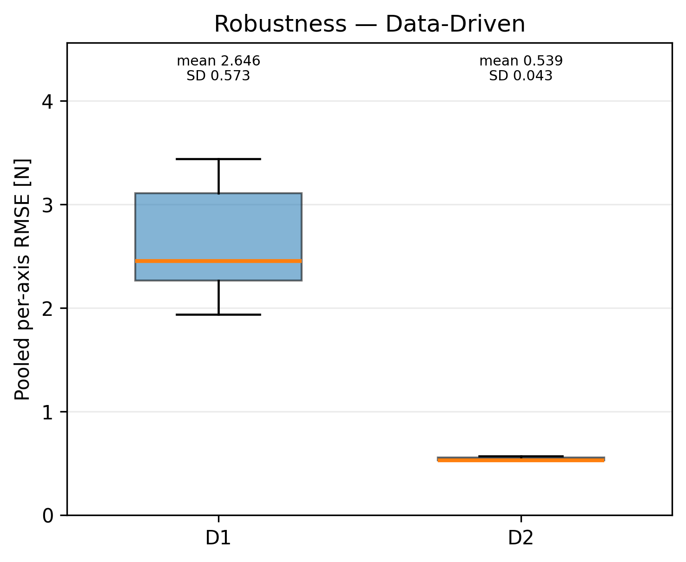

**Test B channel metrics for the key models**

| model | force_channel | rmse_N | normalized_rmse_pct | standard_deviation_N | r2 |
|---|---|---|---|---|---|
| D2 | Fx | 0.593 | 9.883 | 0.594 | 0.967 |
| D2 | Fy | 0.339 | 5.657 | 0.346 | 0.989 |
| D2 | Fz | 0.611 | 10.176 | 0.596 | 0.965 |
| PA0 | Fx | 0.758 | 12.640 | 0.766 | 0.946 |
| PA0 | Fy | 0.397 | 6.620 | 0.368 | 0.985 |
| PA0 | Fz | 0.834 | 13.902 | 0.752 | 0.934 |
| PA1 | Fx | 0.328 | 5.464 | 0.333 | 0.990 |
| PA1 | Fy | 0.393 | 6.556 | 0.408 | 0.985 |
| PA1 | Fz | 0.765 | 12.752 | 0.766 | 0.945 |

Median B/A degradation is PA0 **1.46×**, D2 **1.33×**, D1 **5.27×**, and PA1 **1.22×** (ratio of absolute RMSE). The degradation figure plots the ratio of normalized RMSE, with 4.0 N (Test A) and 6.0 N (Test B) as normalization loads; each plotted value therefore equals the absolute RMSE ratio divided by 1.5.

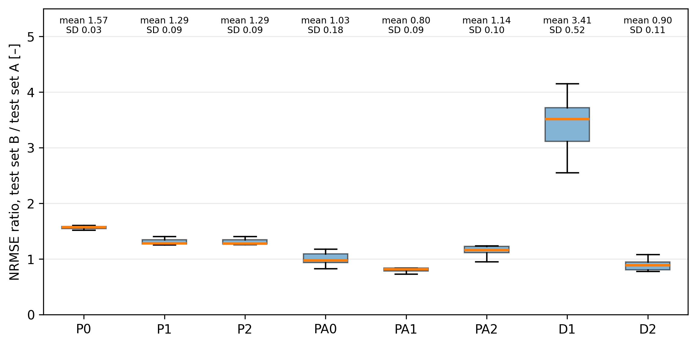

### 4.5.1 Absolute versus normalized error

PA0 normalized RMSE changes from **11.1%** on Test A to **11.7%** on Test B; D2 changes from **10.4%** to **8.8%**. A decrease in normalized error while absolute RMSE increases is consistent with a non-scaling error contribution, but does not by itself identify its physical source.

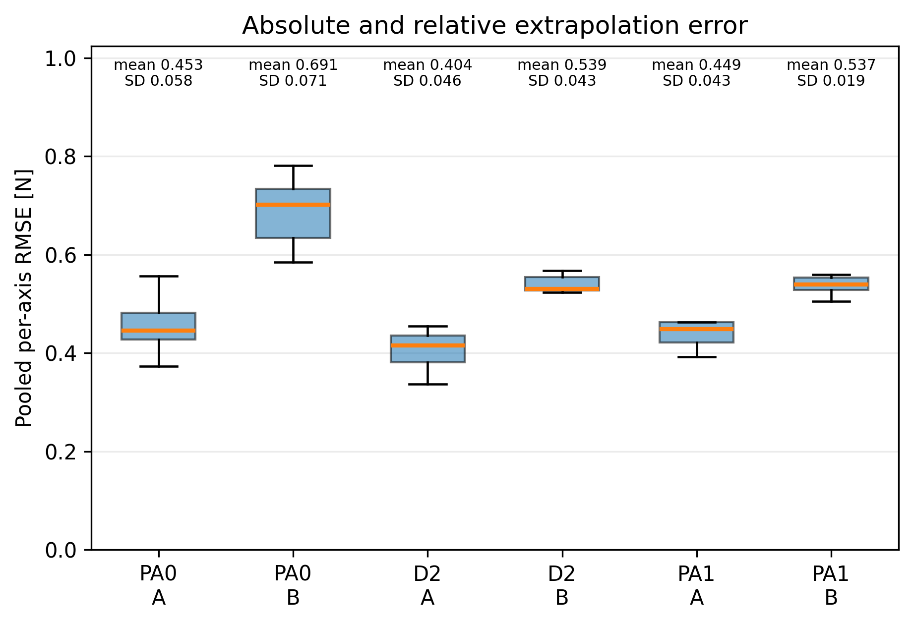

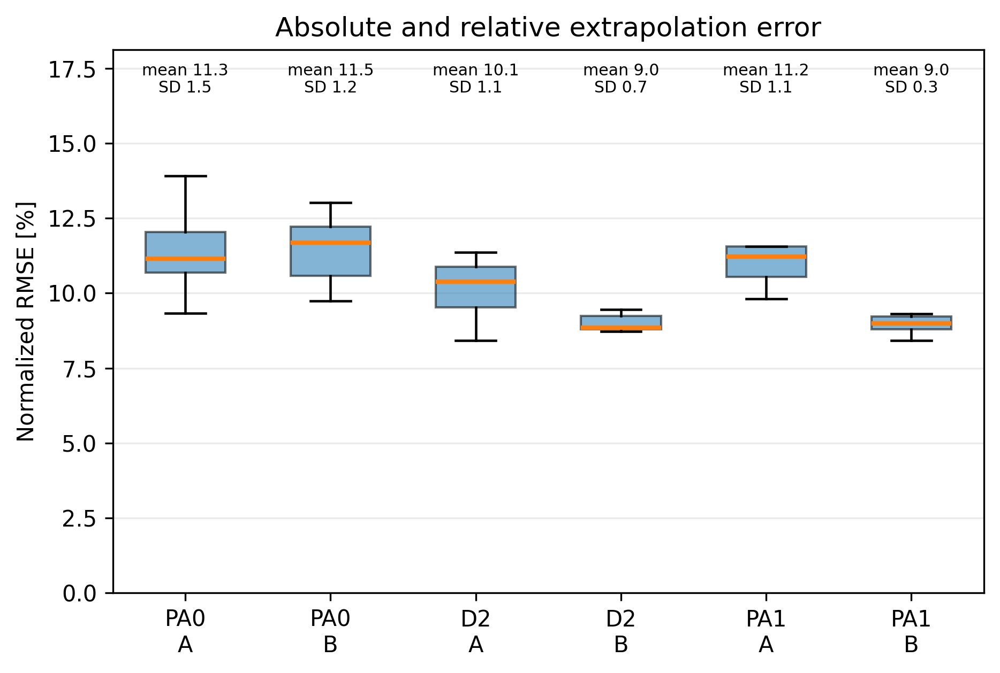

A descriptive linear fit of per-dwell pooled-component RMS error versus load magnitude gives the following intercepts. These are descriptive intercepts, not metrological uncertainty floors.

| model | error_intercept_N | error_slope_N_per_N |
|---|---|---|
| D2 | 0.343 | 0.024 |
| PA0 | 0.228 | 0.056 |
| PA1 | 0.368 | 0.022 |

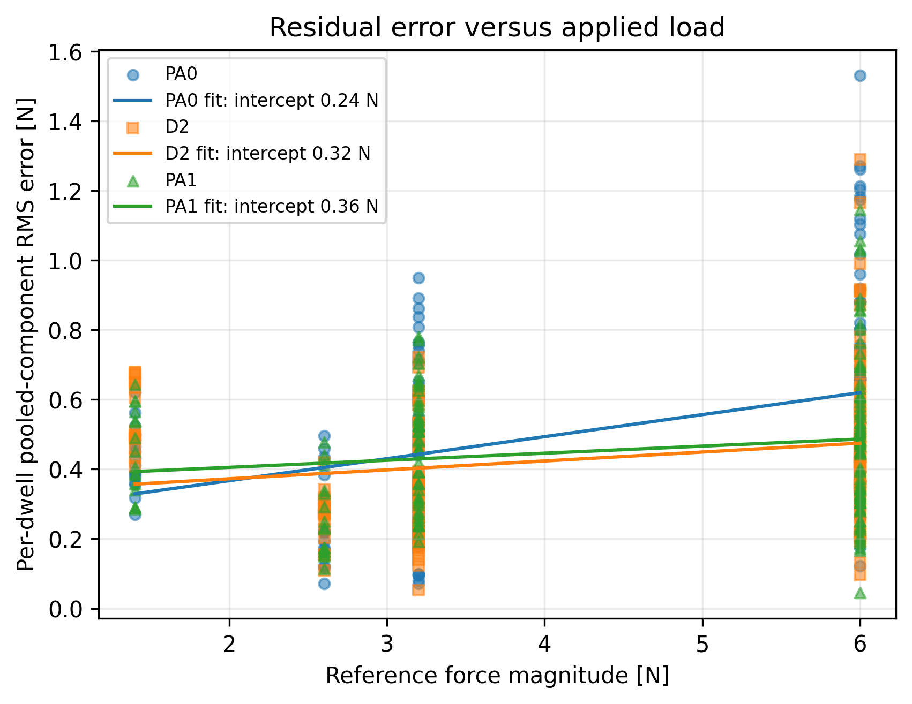

## Discussion hand-off — do not paste into Results unchanged

The following items are the interpretation targets indicated by the feedback:

- **§5.1 / §5.3:** compare the affine and MLP rankings. If D2 remains best across runs, describe PA0 as an interpretability/complexity trade-off rather than the performance winner. D2 uses scikit-learn's default **ReLU** activation, so the trained mapping is piecewise affine; Test B is only a mild amplitude extrapolation.

- **§5.2:** use the PA0 force-block rotation/gain decomposition together with the independent Fy gain/cross-talk evidence and the alignment audit. Keep the decomposition caveat: the full PA0 map is 3×6 because moments are also predictors.

- **§5.2 / §5.4:** if P1≈P2 and PA1≈PA2 across runs, state that the tested shaft-compliance correction is second order for force reconstruction at these loads. Do not extend that claim to distal moment reconstruction, which was not independently excited.

- **§5.3:** explain that bending moments cannot observe axial force, so P1/P2 deliberately pass Fx_EE through directly while reconstructing Fy_EE=-Tz_EE/L and Fz_EE=+Ty_EE/L; PA1/PA2 then calibrate that physically completed representation.

- **§5.5 / §6.2:** use repeatability and cross-remounting transfer to justify whether recalibration is required after remounting.

- **Threshold citations:** the script treats 0.5 N and 2× as declared engineering requirements only. Add the actual source/rationale in §2.4 before presenting them as literature-backed thresholds.

- **Moment overflow:** if any run crosses the configured firmware-risk threshold, resolve that issue before relying on moment-derived model results in the thesis.
